# Challenge 01: the transcript reader on a phone, next pass

**Open the prototype on a phone:**
https://raw.githack.com/haniyaiqbal/whipscribe-buildathon/challenge-01-haniyaiqbal/challenges/01-mobile-transcript/next/index.html

Each screen has its own link: add `#speakers`, `#processing`, `#search`, `#more`, `#download`, `#settings`, `#select`, `#preview_end`, `#signup`, `#error`, `#not_yours` or `#no_audio` to the end. The buttons work too: ⋯, search, the sheets, the text-size and on/off controls.

## The one thing

Someone opens a transcript on a phone to **read it** (and sometimes to listen while reading). So this pass is about giving the words more of the screen and taking things away, not adding them.

## What I took away

| What | Before | After | Why |
|---|---|---|---|
| Header rows | 2 (title row, then meta row) | 1 | The title and "1m 44s · EN" fit on one row. Header and tabs together go from about 118 px to 101 px. |
| Timestamp column | A ~45 px column beside every line | One small time per speaker turn, above the text | At 320 px the column took about 14% of the width and broke sentences into narrow lines. Now each turn gets the full width. You still tap any sentence to play from it. |
| Justified text and hyphens | `text-align: justify` with auto hyphens | Left-aligned, no auto hyphens | Justified text in a narrow column leaves big gaps between words ("Revenue  came  in  11%  above"). |
| Sentence-per-row layout | A sentence could split across two timestamp rows ("a hard / stop at the top of the hour") | Sentences stay together inside the speaker's turn | Rows were cut by audio pauses, not by meaning. |
| Bottom of the screen | Keep reading bar + player + "Audio unavailable" = **158 px** (28% of a 320 × 568 phone) | One slim preview line + one player row = **89 px** (16%) | The text is what people came for. |
| Dead player | Shows 00:00 / 00:00, greyed buttons, and "Audio unavailable" | No player at all when there's no audio (`#no_audio`) | Controls that can't do anything shouldn't take space. |
| Download icon in the tab row | Its own icon | Inside ⋯ → Download or send | On a phone people copy more than they download .srt files. This frees the tab row for the tabs and search. **Honest cost:** downloading a .docx goes from 2 taps to 3. |
| More menu | 9 items | 6 items in 3 groups | See below. |
| "Keep reading" appearing twice at the end | The end-of-preview note *and* the bar both visible | Once you reach the end, the bar goes away and only the card in the text remains | Two asks for the same thing at once feels pushy. |

### The More menu: 9 → 6

| Item | Decision |
|---|---|
| Home | **Removed.** The back arrow already goes there. |
| Sign in | **Removed.** "Keep reading" already leads to it, and a signed-in user never needs it. |
| Timestamps: shown | **Removed.** It's the same switch as in Reading view, so having it in two places was confusing. |
| Quiz me on this recording | **Moved** to the Summary tab, where the "learn from this" things belong. |
| Copy transcript | Kept, renamed **Copy all text**, first in the list because it's the most used. |
| Reading settings | Kept, renamed **Reading view**. |
| Rename, File details | Kept, grouped together. |
| Delete recording | Kept, **in its own group at the bottom**, with "…" because it asks to confirm. It no longer sits between harmless items. |
| (new) Download or send | The old download sheet, now opened from here. |

## What I changed

- **One sheet style for everything** (More, Download, Reading view, Keep reading): same handle, same title row with ✕, same back arrow when one leads to another, Esc closes it. Search is the only panel that isn't a sheet. It needs the keyboard, so it stays at the top under the tabs.
- **Search with the keyboard up** (`#search`): the preview line and player hide while you type, the list jumps to the match, and "1 of 1" stays next to the field.
- **Download sheet** (`#download`): one obvious first choice (Word), then plain text. Subtitles are explained in plain words ("SRT · most video editors"). Translation is one row instead of a dropdown plus a button.
- **Reading view** (`#settings`): text size is three big "A" buttons instead of a small dropdown, plus switches for speaker names and times. It still says it only changes this view.
- **Selecting text** (`#select`): the bar shows *when* the selection was said (0:09–0:10) and offers **Copy with time**, **Play from here** and **Ask in Chat**. Copying with the time means a pasted quote can be found again.
- **Keep reading** (`#signup`): a sheet with Google first and email second, instead of a centred modal with a password form. "Your first transcript is free, no card needed" stays.
- **Load failure** (`#error`): "We couldn't load this transcript. Our server didn't answer in time. Your recording and transcript are safe." **Try again** and **Go to my files**. "Error 503" is still there, small, for support.
- **Another account** (`#not_yours`): the title says "Transcript unavailable" instead of "Loading…" forever. It says which account you're in and gives two ways out.

## New screens the brief asked for

- **Still transcribing** (`#processing`): a thin progress line under the header, "Transcribing · about 20 s left" in the meta line, finished lines readable straight away, and a note: "Still transcribing from 0:29. New lines appear here as they're ready. You can leave this page." Summary and Chat are greyed out until there's something to summarise. The player works because the audio is already uploaded.
- **Four speakers at 320 px** (`#speakers`): each turn starts with a coloured dot, the name and the time (`● Dev 0:09`). Colours are only a helper; the name is always written, so it works for colour-blind readers too. Turns from the same speaker aren't repeated line by line.

## What I kept on purpose

- **Three tabs.** Transcript, Summary and Chat are the right split. I only shortened "AI Chat" to "Chat" so all three fit at 320 px.
- **Tap a line to play from it.** It's the best thing about this reader.
- **The free preview.** Same 48%, same promise. It's just quieter until you reach the end.
- **The download formats.** All the same ones are still there, just grouped.

## Questions from the brief

- **How many taps to read?** Zero, before and after. What changes is how much you see: at 320 × 568 the first screen shows 11 lines of transcript instead of 9, and each line is wider.
- **Keyboard up?** The preview line and player hide while the search field has focus, so the keyboard only covers the bottom of the transcript, not two bars plus the transcript.
- **Search, download, settings as one?** Download and settings are now the same kind of sheet. Search stays different on purpose, because it needs the keyboard.
- **Should the desktop change?** Not in this pass. The desktop page has room for the timestamp column. I'd only bring over the left-aligned text and the speaker headers. I didn't redesign it here.

## Before and after

Every screen I changed, current on the left and mine on the right (390 px unless marked):

| | |
|---|---|
| Reader | 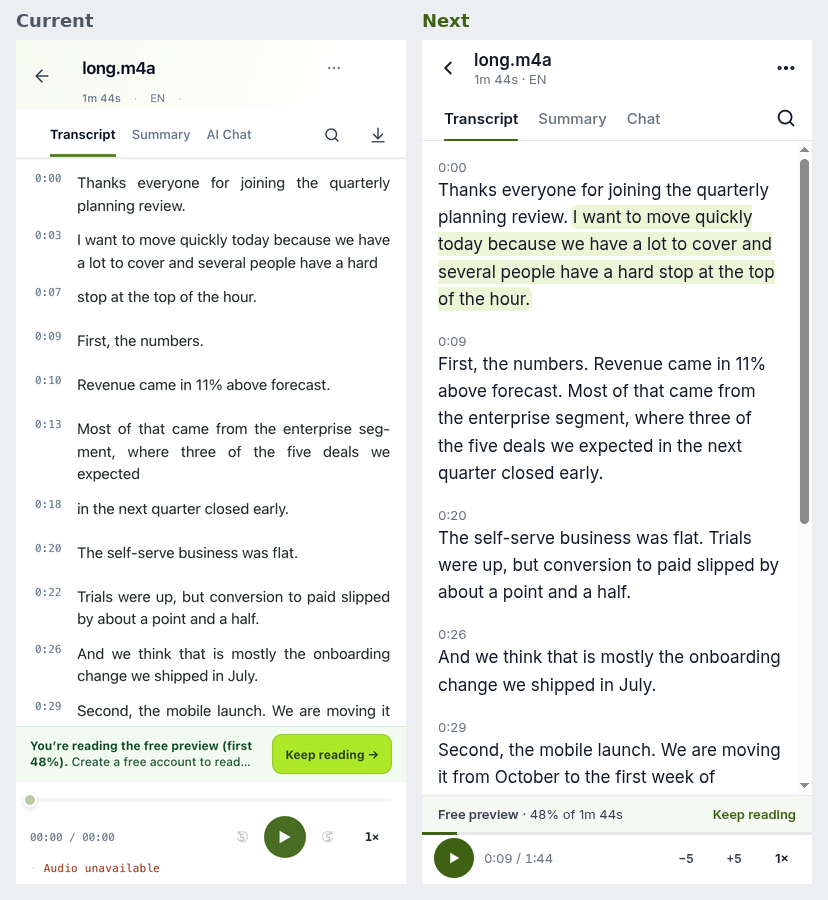 |
| Reader at 320 px | 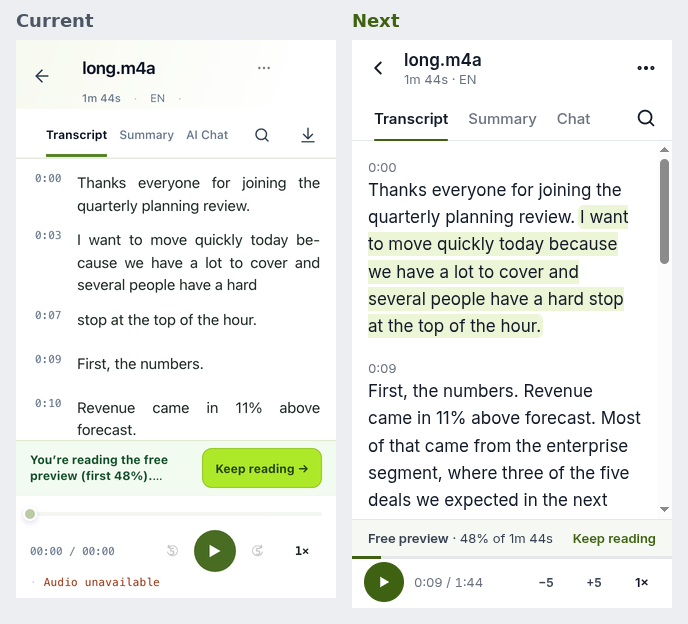 |
| Four speakers at 320 px (new) | 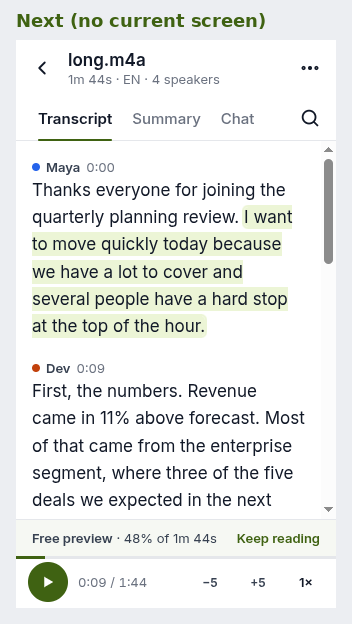 |
| Still transcribing (new) | 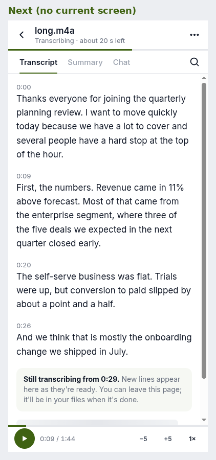 |
| End of free preview | 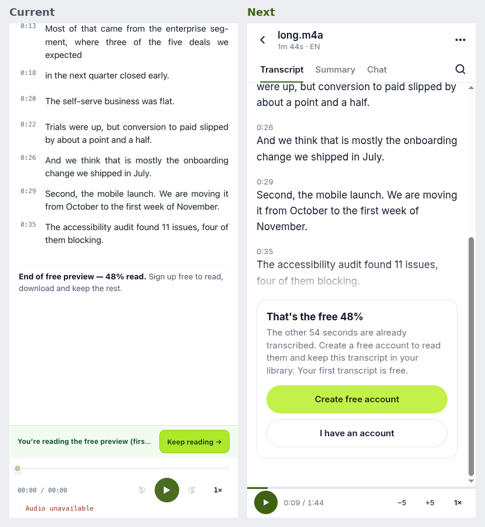 |
| Search with keyboard | 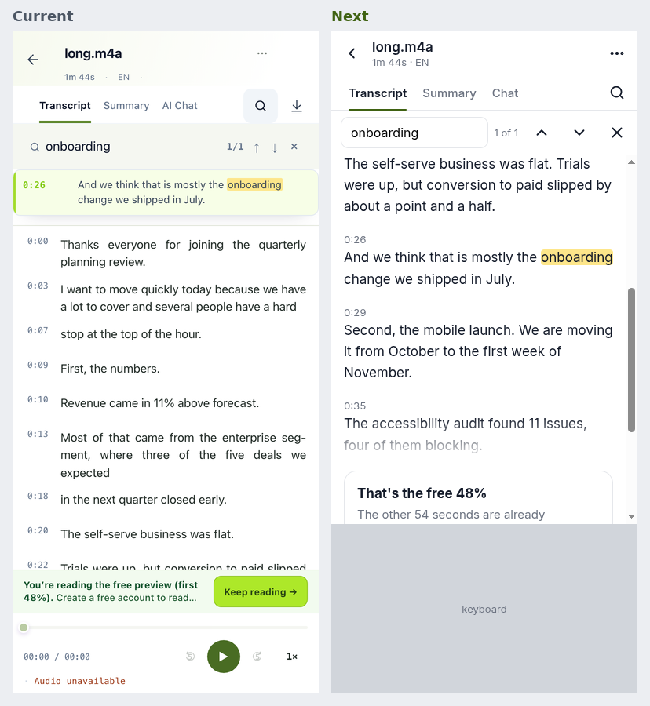 |
| Download | 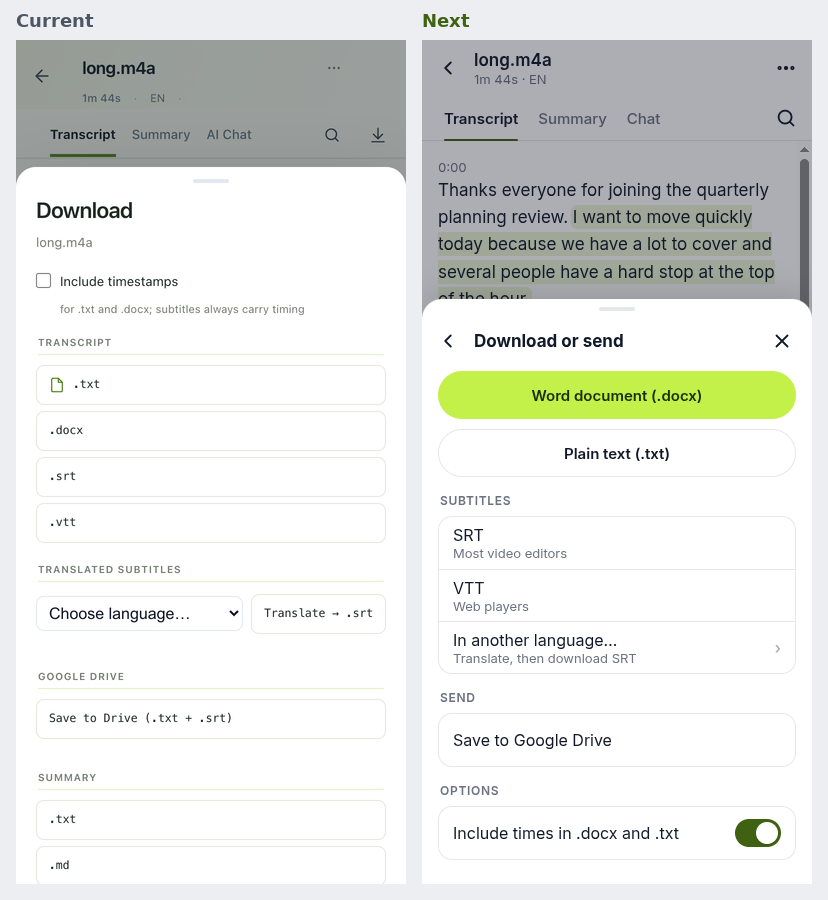 |
| More menu | 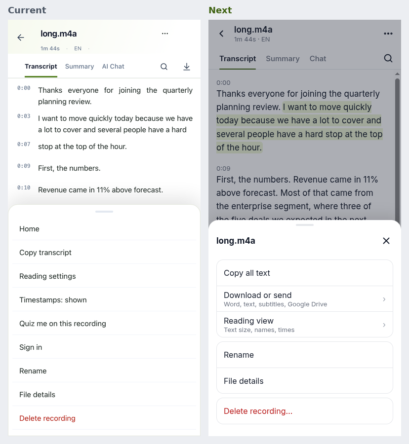 |
| Reading view | 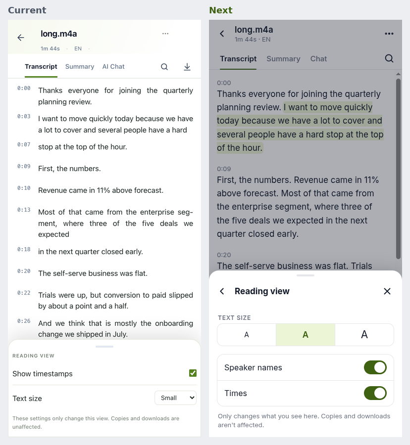 |
| Selecting text | 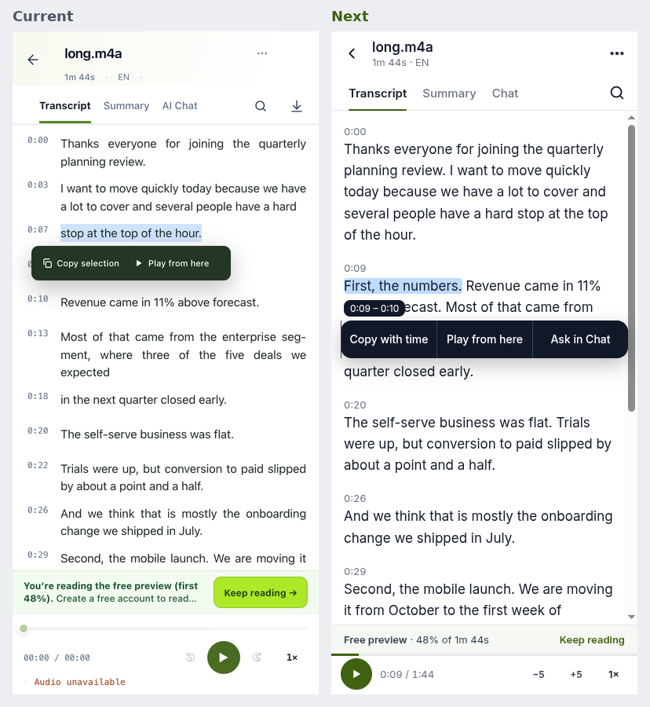 |
| Keep reading | 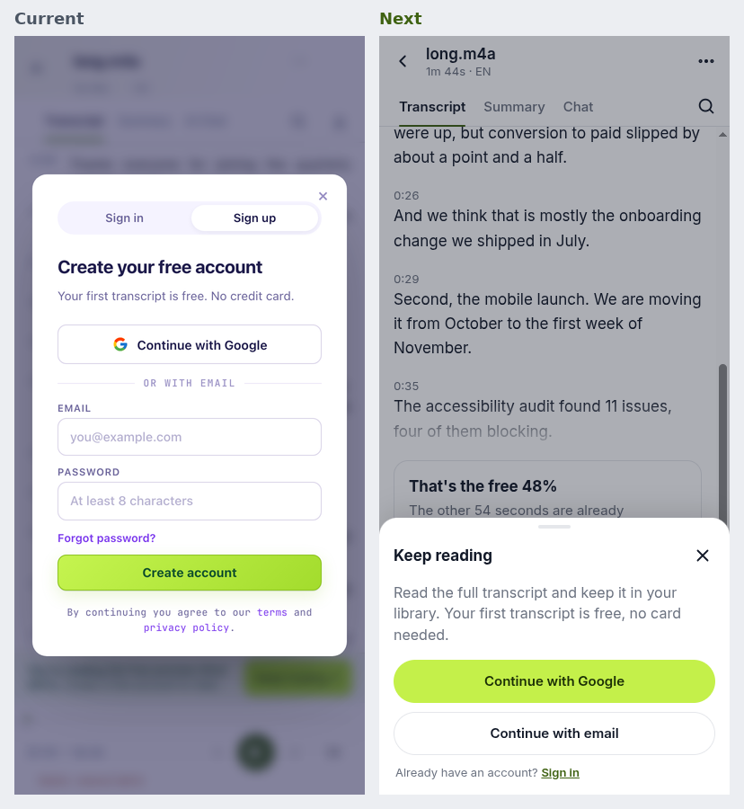 |
| Load failure | 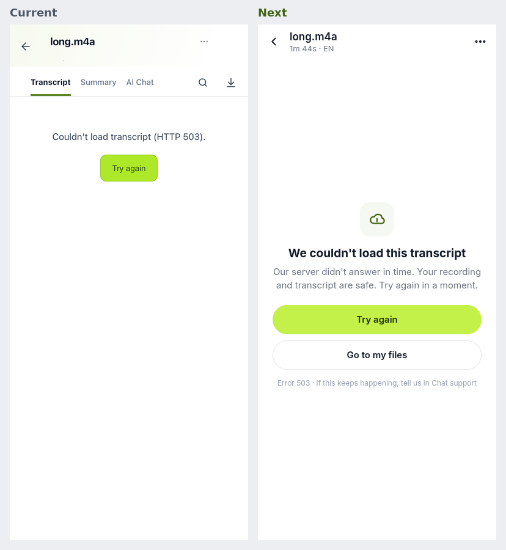 |
| Another account | 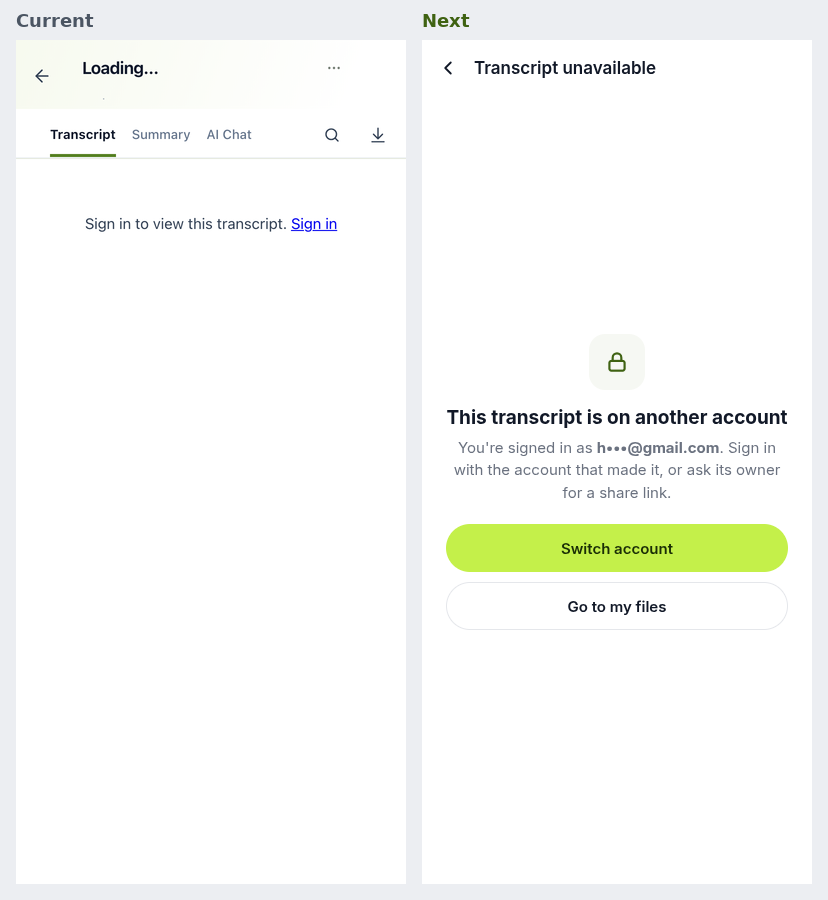 |
| No audio | 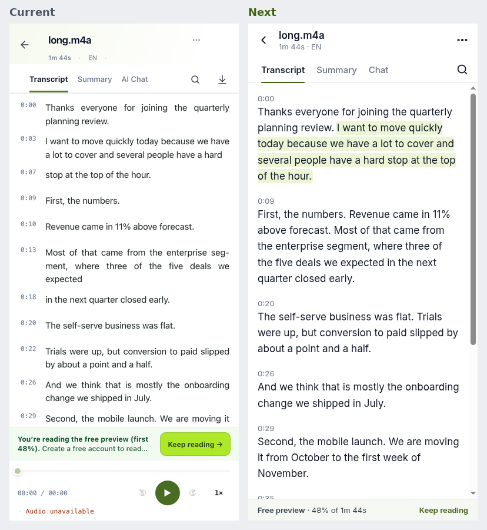 |

## What this is not

- It's a clickable mockup, not the real app. Nothing loads from the API, and the player doesn't play.
- The speaker names (Maya, Dev, Priya, Tom) are made up. I split the same meeting text from the current screenshots between four people to show the layout.
- Text selection is drawn, not the phone's real selection. On a real phone the bar would appear after the system's own handles.
- The keyboard in the search screen is a grey placeholder at a typical height (216 px).
- I didn't draw the Summary tab (where Quiz would move), the delete confirmation, or the translate step.
- I haven't tested it with a screen reader yet. Controls have labels, sheets are marked as dialogs, and the switches have roles, but that's not the same as testing.

## How I built it

One HTML file, no build step, so it opens on any phone. I measured the current screens, decided what to remove and change, and used AI tools to build the HTML mockup faster. Then I used Playwright to open the prototype at phone sizes (390 × 844 and 320 × 568) and screenshot every state. I reviewed each screen and fixed what was wrong:

- The first draft labelled every paragraph "Speaker" in the one-speaker file. That repeated nothing useful, so one-speaker files now show only the time.
- The selection bar was first placed at a fixed height and covered the selected words. It now sits just under the selection.
- The search screen opened at the top of the transcript with the match off-screen. It now scrolls to the match.
- On the "another account" screen, the ⋯ menu offered actions for a file you can't open. It's gone there.
